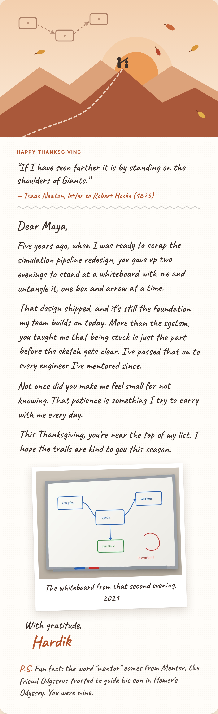

# PersonalAISkills

Small, careful AI skills for human connection. They use AI to help people show
up better for each other, not to stand in for them.



## Skills

| Skill | What it does | Try saying |
|---|---|---|
| [ThankYou](skills/thankyou/SKILL.md) | A one-of-one thank-you note for any occasion. It opens with a fitting, correctly attributed quote, recalls the specific moment the person made a real difference, uses your native language where it fits, and adds a small artwork drawn only for them. | "Write a Thanksgiving thank-you note to my mentor Maya" |
| [Reconnect](skills/reconnect/SKILL.md) | Finds people you've drifted from, and quietly leaves alone the ones you drifted from on purpose. Then it drafts a short, no-guilt check-in built on a real shared memory, a festival they celebrate, or a "thought of you" moment. | "Who have I lost touch with?" or "Help me reconnect with Arjun" |

## Install

In Claude, add **PersonalAISkills** from the plugin directory (Customize → Plugins),
once it is listed there. In Claude Code you can install it straight from GitHub:

```
/plugin install personalaiskills --marketplace hardikashah-eng/personalaiskills
```

The skills work best with your email or chat connected to Claude. They also
work without any connectors: Claude asks you a few short questions instead.

## Principles

- **Specific over generic.** Find the real moment, not a template.
- **Private by default.** Personal connectors are read-only and used only with
  permission, and nothing sensitive ends up in the output.
- **Kind always.** Tone fits the relationship (spouse, parent, elder, sibling,
  friend, mentor, colleague…) and the recipient's culture, and the skills steer
  around topics that could hurt.
- **The human sends.** The skills draft; you review, edit, and send.

## Privacy and data handling

This plugin contains only skills (instructions and two small helper scripts).
It has no hooks, no MCP servers, no package installs, and makes no network
requests of its own.

**What it reads.** To find a real moment to mention, Claude may search the
communication tools *you have already connected* to Claude, such as email,
Slack, Microsoft Teams, Lark/Feishu, LinkedIn and calendar. It reads only what
it needs about the one person you're writing to. WhatsApp and SMS/iMessage are
read only after you explicitly allow it for that note, and only your 1:1 thread
with that person. Claude shows you a one-line summary of the moment it found
and uses it only after you confirm.

**What it never does.** It never sends, posts, replies, or reacts on your behalf.
It creates an email draft only when you ask for one. It does not store your
messages, contacts or notes anywhere, including memory, and it sends no data
to any third party.

**What stays out of every note.** Contact details, addresses, ID or account
numbers, money amounts and other financial details, and health information.
Moments that involve these are rewritten in general terms ("you stepped in
when I needed it most"). Reconnect never suggests people from a conflict, exes,
estranged family, or anyone who may have passed away.

**What runs on your machine.** When a skill is used in an environment that can
run code, Claude may run two Python 3 scripts (standard library only, no
network access):

- `skills/thankyou/scripts/safety_check.py` reads a draft note (JSON) and
  flags contact details, money amounts, financial and health terms, topics to
  avoid, and harsh or guilt-inducing wording. It prints a report and writes nothing.
- `skills/thankyou/scripts/render_card.py` turns a note and an optional SVG
  drawing into a self-contained HTML card file at the path you choose. It
  strips scripts and external links from the SVG.

Where scripts can't run, the skills do the same checks by hand.

All people in `examples/` are fictional.

## Layout

```
.claude-plugin/plugin.json   # plugin manifest
skills/<name>/
  SKILL.md                   # instructions Claude follows
  references/                # detailed guidance loaded on demand
  scripts/                   # helper scripts (ThankYou; shared with Reconnect)
  examples/                  # finished samples
```

Reconnect reuses ThankYou's safety check (`--profile reconnect`), card
renderer, and its language, art, relationship and culture guides.

## Try the scripts locally

```bash
cd skills/thankyou
python3 scripts/safety_check.py examples/maya-thanksgiving/note.json
python3 scripts/render_card.py examples/maya-thanksgiving/note.json \
  --art examples/maya-thanksgiving/art.svg --out /tmp/maya.html
```

Requires Python 3.9 or later; no dependencies.

## License

[MIT](LICENSE)
