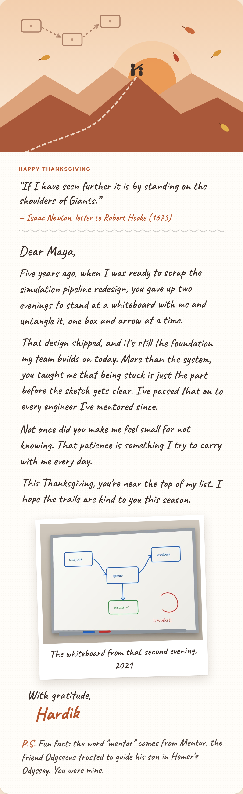

# PersonalAISkills

Small, careful AI skills for human connection. They use AI to help people show
up better for each other, not to stand in for them.



## Skills

All skills live in `skills/`, the standard plugin layout every Claude app reads. They're grouped here (and in [skills/README.md](skills/README.md)) by where you'll use them. ThankYou's `--team` and `--org` modes and Comfort work just as well with colleagues.

### Personal

For family, friends and the people who shaped you.

| Skill | What it does | Try saying |
|---|---|---|
| [ThankYou](skills/thankyou/SKILL.md) | A one-of-one thank-you note for any occasion, to a person, a team (`--team`), an organization (`--org`), or family (`--family`). It opens with a fitting, correctly attributed quote, recalls the specific moment or shared achievement that made a real difference, uses your native language where it fits, can show how you are paying it forward, and adds a small artwork drawn only for them plus a photo from a good time together, or a pencil sketch of the moment when there is no photo. The card is written in handwriting, and Claude helps deliver it by email, WhatsApp, text, Slack and more. | "Write a Thanksgiving thank-you note to my mentor Maya" or "/thankyou --team Platform Thanksgiving" |
| [Reconnect](skills/reconnect/SKILL.md) | Finds people you've drifted from, and quietly leaves alone the ones you drifted from on purpose. Then it drafts a short, no-guilt check-in built on a real shared memory (often a photo from that time), a festival they celebrate, or a "thought of you" moment. | "Who have I lost touch with?" or "Help me reconnect with Arjun" |
| [Grateful](skills/grateful/SKILL.md) | A seasonal gratitude list (Thanksgiving, Diwali, year-end) of the people, moments and facts you're grateful for. Each entry gives a safe reason, the real difference it made, and how you're paying it forward. It opens with a quote and a pencil sketch of the occasion or feeling, in handwriting, in your language, private by default or ready to share. | "What am I grateful for this Thanksgiving?" or "/grateful Diwali --family" |
| [Comfort](skills/comfort/SKILL.md) | A short, steady message for someone going through a hard time: a loss, an illness, a layoff, a breakup, a hard anniversary. It acknowledges without fixing or minimising, offers one specific kind of help, can add a gentle thought about something warm to eat (or a meal you'll bring), and follows their culture and faith. Only when you say they'd welcome it, and never for a fresh loss, it adds a link to a comedy scene for a smile. Nothing is sent without your yes. | "Help me write to Priya, her dad passed away" or "/comfort Rohan layoff via whatsapp" |
| [Story Keeper](skills/story-keeper/SKILL.md) | Keeps a parent's or grandparent's life stories in a family booklet: gentle interview questions in their language, their stories in their own words, the family's photos (or pencil sketches of them), and short clips of their real voice cut from family videos. Consent first, private by default, and voices are never cloned or altered. | "Help me record Nani's stories for Diwali" |

### Professional

Everyday habits for engineers and leaders.

| Skill | What it does | Try saying |
|---|---|---|
| [Kudos](skills/kudos/SKILL.md) | Specific recognition for real work (a merged PR, a resolved incident, a design doc, an on-call shift), written by reading the work itself. It names what the person did, the difference it made and the care behind it, as a DM, a #kudos post (Slack, Lark, Teams), a note to their manager, or, for public work with their OK, a LinkedIn post. It can log the strength for 1:1s and reviews. | "Thank Bea for the retry fix in #482 and post it in #kudos" |
| [Feedback](skills/feedback/SKILL.md) | Constructive feedback shaped as what happened, what it affected and what to try next, starting from what's going well. It prepares 1:1 talking points and a written recap, blocks labels and absolutes, and once shared, adds the item to your private growth log of improvement opportunities with a follow-up date. | "Help me give Dami feedback on her design reviews" |
| [Intro](skills/intro/SKILL.md) | Warm, double opt-in introductions: a private ask to each person first, then, once both say yes, a short intro with a clear reason and one easy next step. | "Introduce Chen to Ola, who built the tiling pass" |
| [Welcome](skills/welcome/SKILL.md) | A first-week note for a new hire or team member (why the team is glad, the shape of the week, their buddy), a team introduction with only what they agreed to share, and an optional card. | "Welcome Kenji, who starts Monday" |
| [Repair](skills/repair/SKILL.md) | A sincere apology or follow-up after a tense meeting, a sharp comment or a missed commitment. It owns what happened without excuses, says what will change, and blocks non-apologies. | "Help me follow up with Ravi after planning" |
| [Nudge](skills/nudge/SKILL.md) | The daily and after-meeting list of people moments, each with a ready draft to approve: kudos for work and praise heard in meetings, private feedback prompts, commitments to follow up, first days, people not recognized lately. | "After standup" or "What should I follow up on today?" |
| [Routines](skills/routines/SKILL.md) | Puts the habits on a schedule, if you want: a daily people brief, an after-standup scan, a Friday kudos sweep, Monday growth follow-ups and 1:1 prep, or a monthly reconnect. It asks a few questions, shows the plan, and creates each routine with your app's scheduler only after you say yes. Every run sends you one review list; nothing goes out without your approval. | "Set up my routines" or "Do this every Friday" |

### Professional: teamwork

Showcasing great teamwork, and finding and elevating the people who make it happen.

| Skill | What it does | Try saying |
|---|---|---|
| [Spotlight](skills/spotlight/SKILL.md) | Finds people who consistently go above and beyond, from a pattern over weeks across several sources and colleagues (help on reviews, incidents outside their rota, mentoring, docs other teams use, peer thanks), never one big launch. It turns that into an impact story with links to the work, then into sponsorship: a nomination, a note to their manager and skip-level, a stretch opportunity, an introduction. It also flags when the extra effort may not be sustainable. No scores or rankings. | "Who has been quietly carrying the team this quarter?" or "Help me nominate Chen" |
| [Team Story](skills/team-story/SKILL.md) | Tells a project or quarter through everyone's contributions, including reviews, docs, on-call and help from other teams, as a one-page highlight reel with a "who helped whom" map (connections, not rankings), quotes and thanks, plus a #wins post, an all-hands slide outline and a note for leadership. | "Make a Team Story for the build-queue project" |
| [Peer Pulse](skills/peer-pulse/SKILL.md) | A one-minute weekly prompt ("Who helped you this week, and how?") answered privately, then turned into thank-you drafts quoting peers as they allowed, and into evidence for Spotlight and Team Story. Personal answers are held for you and never stored. | "Start a Peer Pulse for the Platform team" |
| [Tribute](skills/tribute/SKILL.md) | A group card for a farewell, retirement, milestone birthday or promotion. It writes the request to contributors, checks every message for kindness and privacy, and weaves them into one card with everyone credited, a group photo or sketch, a quote, and optionally a link to a favourite comedy scene or a public-domain short film. | "Make a farewell card for Meena from the team" |

## Install

In Claude, add **PersonalAISkills** from the plugin directory (Customize → Plugins).

This is the directory edition: the same skills as the
[full edition on GitHub](https://github.com/hardikashah-eng/personalaiskills),
with every helper script rewritten as instructions, so it is Markdown and
images only. The full edition, with its scripts, installs in Claude Code from
the repository's own marketplace.

The skills work best with your email or chat connected to Claude. They also
work without any connectors: Claude asks you a few short questions instead.

## Principles

- **Specific over generic.** Find the real moment, not a template.
- **Private by default.** Personal connectors are read-only and used only with
  permission, and nothing sensitive ends up in the output.
- **Kind always.** Tone fits the relationship (spouse, parent, elder, sibling,
  friend, mentor, colleague…) and the recipient's culture, and the skills steer
  around topics that could hurt.
- **A light P.S.** Cards can end with one short, true fun fact tied to the
  relationship or occasion, drawn from a verified fact bank with sources.
- **Comedy by link, never copied.** Comfort and Tribute can point to a favourite
  sitcom scene on the show's or studio's official channel, or to a truly
  public-domain film (US releases before 1929). Clips are never downloaded,
  re-hosted or quoted at length, and humour is added only when it's welcome.
- **Real voices, real photos.** Story Keeper uses the family's own photos and
  short clips of the elder's real voice; it never clones, synthesizes or
  splices a voice, or "restores" a face with AI.
- **Automate the finding, not the sending.** Scheduled runs and after-meeting
  scans prepare drafts and a review list ([AUTOMATION.md](https://github.com/hardikashah-eng/personalaiskills/blob/main/AUTOMATION.md)); you
  approve each message. Feedback stays private, and nothing is posted publicly
  without the person's OK.
- **You decide what's sent.** The skills draft; you review and edit. Nothing
  is sent or posted without your explicit yes to the exact message.

## Privacy and data handling

This plugin contains only skills: Markdown instructions and example images.
It has no scripts, hooks, MCP servers or package installs, and makes no
network requests of its own.

**What it reads.** To find a real moment to mention, Claude may search the
communication tools *you have already connected* to Claude, such as email,
Slack, Microsoft Teams, Lark/Feishu, LinkedIn and calendar. It reads only what
it needs about the one person you're writing to. WhatsApp and SMS/iMessage are
read only after you explicitly allow it for that note, and only your 1:1 thread
with that person. Claude shows you a one-line summary of the moment it found
and uses it only after you confirm.

**Photos.** A note can include a photo from a good time you shared. Photos
come only from your own sources: a photo library or drive you've connected, a
photo you attach, or photos the two of you already exchanged (WhatsApp and SMS
with the same opt-in as above). Claude finds candidates by the date, album or
thread of the moment, never by recognising faces, and never takes photos from
the web, social media or profile pictures. You choose the photo. Claude never
retouches, alters or generates a person. Before a photo goes into a card or
draft, its hidden data (GPS location, camera details, timestamps) is removed.
Cards with personal photos are kept as files or drafts, not shareable links,
unless you ask.

**Pencil sketches and stock photos.** When there is no suitable photo, Claude
draws an original pencil-style sketch of the scene, with no faces or
likenesses of real people. If you'd like something closer to a photograph,
Claude may instead look up a freely licensed stock photo of a place or object
(public domain, CC0, or a free-to-use licence such as Unsplash's or Pexels'),
using Claude's own web tools, and turn it into a pencil sketch. It never uses
photos of people, public figures or anything from social media, and it credits
the author when the licence asks. A sketch or stock image is never described
as a real photo of your moment.

**Delivery and sending.** When the note is ready, Claude helps you deliver it
on the channel you choose: email (Gmail, Outlook), Slack, Microsoft Teams,
Lark/Feishu, LinkedIn, WhatsApp, SMS/iMessage, Telegram, Signal, WeChat, LINE,
KakaoTalk, or a printed card. **Claude sends or posts only after you say yes to
that exact message, recipient and channel**, shown to you in full first. "Looks
good" about the wording isn't taken as a yes to send. Without a yes, it creates a
draft, or gives you the text, the card as an image, and a link that opens the
app with the message filled in, so you send it yourself. It never sends
unattended or on a schedule, never adds other recipients, and never posts a
personal note to a group you didn't pick. Phone numbers and email addresses are
used only for that send and never saved.

**What it never does.** While looking for the moment, it only reads: it never
replies, reacts, or posts. It does not store your messages, contacts or notes
anywhere, including memory, and it sends no data to any third party.

**What stays out of every note.** Contact details, addresses, ID or account
numbers, money amounts and other financial details, and health information.
Moments that involve these are rewritten in general terms ("you stepped in
when I needed it most"). Reconnect never suggests people from a conflict, exes,
estranged family, or anyone who may have passed away.

**What runs on your machine.** Nothing. This edition is Markdown instructions
and example images only: no scripts, programs, fonts or downloads. Every step
(the safety check, building a card or booklet, the channel text and share
links, the growth log, the transcript scan, the Spotlight pattern check, the
Peer Pulse tally, the routine prompts) is written as instructions Claude
follows itself. Claude uses only the tools already available in your session:
it writes the card as an HTML file, and removes a photo's metadata or saves the
card as an image only if your environment can; otherwise it leaves the photo
out, or asks you to take a screenshot.

**Meeting transcripts.** Nudge uses transcripts only from meetings you
organized or attended where transcription was announced, never HR, medical or
legal meetings. It quotes at most a sentence back to you, and stores nothing.

**Spotlight, Team Story and Peer Pulse.** Evidence about colleagues stays in a
file you keep, for spotting who to elevate, never for criticizing anyone or
ranking people. Peer Pulse answers are quoted only as each writer allows;
personal answers aren't stored. Workload flags are prompts to ask, never
guesses about anyone's health or life.

**The growth log.** Feedback and Kudos can add entries to a log file you keep
(or a Sheet, Lark Base or Notion database you connect). Entries are added
only after you've shared the feedback with the person, hold strengths as well
as growth areas, and are never saved to Claude's memory.

**LinkedIn.** Kudos drafts a LinkedIn post only for public work, records the
person's consent, and checks it with the public-post checks (no ticket
numbers, internal links, confidential or unreleased work). You paste
and post it yourself; if you ask, Claude fills in the post in your browser and
stops before **Post**.

**Links to comedy scenes.** Comfort and Tribute only ever link to an official
source (the show's, studio's or network's own channel or streaming service) or
to a public-domain film on Wikimedia Commons or the Internet Archive. Opening
the link is the reader's choice; nothing is fetched when a card opens.

**Family stories and voices.** Story Keeper's booklets are private by default
("Shared only with the family"). Stories, photos and voice clips are used only
with the elder's or the family's agreement, and are never saved to memory.

**Fonts.** Cards are written in a handwriting typeface already on the
reader's computer, so nothing is fetched when a card opens.

All people in `examples/` are fictional, the example photos are illustrated
stand-ins, and the sketches were drawn by the skill (as SVG, saved here as PNG
images). The Story Keeper example leaves its voice clip out.

## Layout

```
.claude-plugin/plugin.json   # plugin manifest
skills/README.md             # the skills, grouped: personal, professional, teamwork
skills/<name>/
  SKILL.md                   # instructions Claude follows
  references/                # detailed guidance loaded on demand
  examples/                  # finished samples
```

Every other skill reuses ThankYou's guides: the safety checklist (with extra
checks for each kind of note), card layout, channel formats and share links,
photos and card images, language, quotes, sketches, safety, delivery, and
relationships and culture.

## License

[MIT](LICENSE)
